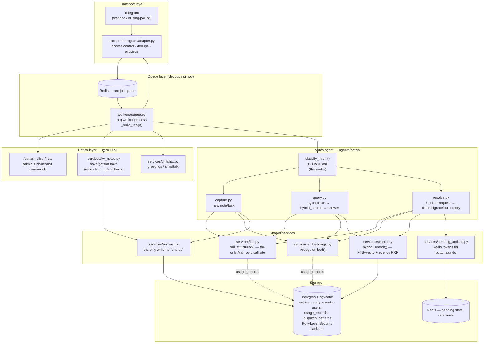
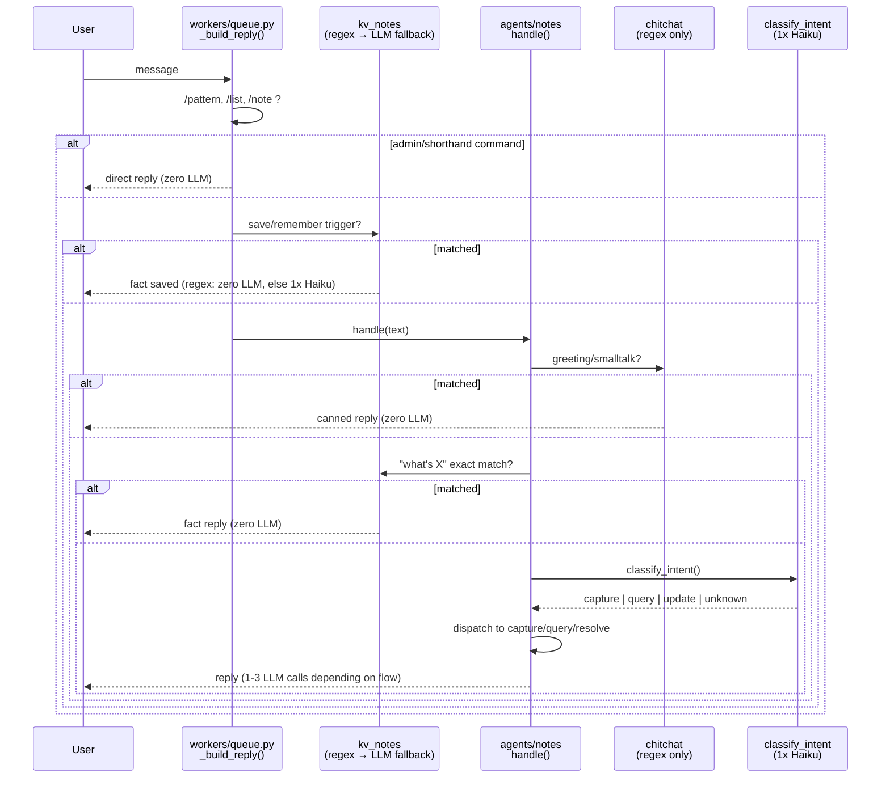
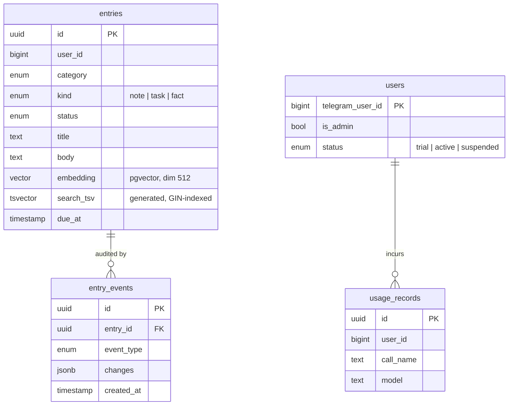

# Agent architecture

A system-level view of how the "multi-agent" part of this system is actually put together:
what an agent is here, how a message gets routed to one, and how the pieces around it (queue,
storage, reflexes) fit. This consolidates the architecture-relevant parts of the HLD/LLD and
`request-flow.md` into one picture — for exact function signatures and line-by-line behavior,
those docs (linked at the bottom) remain the source of truth.

## 1. The shape of it, today

There is **one implemented agent** (`agents/notes/`) sitting inside a queue-driven pipeline,
guarded by two layers of zero-LLM dispatch. It is not a multi-agent framework (no LangGraph /
CrewAI / AutoGen, no agent-to-agent messaging, no shared "agent" base class) — agents here are
plain async Python modules with functions, selected by a router that is itself a single cheap
LLM call.

## 2. What "agent" means in this codebase

An agent is a Python package under `agents/` exposing a single `handle()` entry point plus a
router (`classify_intent`) that decides which internal flow gets the message. There's no
abstract base class or plugin registry — the HLD's planned `core/router.py:route(user_id, text)
-> AgentName` (for choosing *between* agents once more than one exists) was never built, since
only one agent exists so far. That's the main documented-but-unbuilt seam for future growth
(job-application pipeline, recall/memory agent — see README).

**`agents/notes/`** owns notes, tasks, and personal facts, and has three flows behind one
router:

| Flow | File | Router action | Job | LLM calls |
|---|---|---|---|---|
| Capture | `capture.py` | `capture` | free text → structured entry (note/task) | 1x Sonnet extract + 1x Voyage embed |
| Query | `query.py` | `query` | question → filtered/ranked search → synthesized answer | 1x Haiku plan + 1x Voyage embed + 1x Sonnet synthesis |
| Resolve | `resolve.py` | `update` | "mark X done" → find entry, disambiguate or auto-apply | 1x Haiku extract + 1x Voyage embed (no LLM to apply) |

The router itself (`classify_intent`, 1x Haiku call) buckets a message into
`capture | update | query | unknown` before any of the three flows run.

## 3. Two-layer dispatch, not one

A message passes through **two** dispatchers before it ever reaches the LLM router — this is
the system's main cost-control mechanism: cheap, deterministic checks run first, and every
message that resolves at a reflex layer never pays for an LLM call at all.

**Layer 1 — `workers/queue.py:_build_reply()`**: matches on literal message shape
(`/pattern`, `/list`, `/note ...`, save/remember trigger words). Fully outside the agent.

**Layer 2 — `agents/notes/__init__.py:handle()`**: the agent's own front door — chitchat regex,
then a "what's X" fact shortcut, then the actual LLM router (`classify_intent`), then dispatch
to `capture()` / `query()` / `resolve()`.

Neither layer is agent-to-agent messaging; it's a straight function-call chain inside one
worker process. There's no message bus — coordination is via two shared resources instead:

- **Redis (arq queue)** — the one real async decoupling point: transport enqueues, the worker
  process consumes independently. Same mechanism carries button-callback jobs.
- **Redis (`pending_actions`)** — short-lived (1h TTL) tokens so a later, independent Telegram
  button press (disambiguation choice, Undo) can resume a specific operation without re-running
  extraction. Closest thing to an event in this system.
- **Postgres (`entries` table + `hybrid_search()`)** — the shared memory every flow reads and
  writes through; this is what would let a future second agent "see" what the notes agent
  captured, via the `searchable_items` view rather than by messaging the notes agent directly.

## 4. Storage: one table, one writer, one search function

All three domains — notes, tasks, personal facts — live in a single `entries` table
(`db/models.py:Entry`), written exclusively through `services/entries.py`. Every mutation also
writes an `entry_events` row (audit trail), which is what powers generic Undo.

`services/search.py:hybrid_search()` is the single query surface all three flows read through
(over a `searchable_items` view, not the table directly — deliberately, so a future agent could
union its own rows into that view without touching this SQL). It blends full-text rank, vector
cosine distance, and a recency decay into one Reciprocal-Rank-Fusion-style score — all three
signals are optional/tunable per call (e.g. `resolve.py` skips the similarity floor to always
get its top-2 disambiguation candidates).

**Multi-tenancy**: every write/read is already scoped by `user_id`; Postgres Row-Level Security
is layered underneath as a backstop (`db/session.py:tenant_session()` sets
`app.current_user_id` per transaction), enforced only when the app connects as the restricted
`notes_app` role rather than the superuser.

## 5. External dependencies

| System | Used for | Where |
|---|---|---|
| Telegram Bot API (aiogram) | only transport in/out | `transport/telegram/adapter.py` |
| Anthropic (Claude Haiku + Sonnet) | intent routing, extraction, synthesis | `services/llm.py:call_structured()` (only call site) |
| Voyage AI (`voyage-3-lite`) | embeddings for capture/query/resolve | `services/embeddings.py` |
| Langfuse | tracing every LLM call | wired into `call_structured()` |
| Postgres + pgvector | system of record | `db/` |
| Redis | job queue, pending-action tokens, rate limiting | `workers/pool.py`, `services/pending_actions.py`, `services/rate_limit.py` |

## 6. Where this is headed

The README and HLD describe this as the first of several agents — a job-application pipeline
and a recall/memory agent are planned, dispatched by the currently-unbuilt `core/router.py`.
The design already leaves room for that: the `searchable_items` view is meant to be unioned
across agents' own tables, and `Reply`/`Button` (in `core/schemas.py`) are transport-neutral so
any future agent can hand the worker a reply without touching Telegram code directly. Adding a
second agent would mean: a new `agents/<name>/` package, its own tables (or `UNION ALL` into
`searchable_items`), and promoting today's inline `classify_intent()` dispatch in
`workers/queue.py` into an actual cross-agent router.

## Related docs

- [`request-flow.md`](request-flow.md) — exact stage-by-stage trace of one message, with a
  Mermaid diagram and which calls are zero-LLM (this doc's §3 sequence diagram is a
  higher-altitude version of the same thing).
- [`notes-agent-hld.md`](notes-agent-hld.md) — original spec: requirements, data model, LLM
  contracts, phased build plan.
- [`notes-agent-lld.md`](notes-agent-lld.md) — as-built: real schemas/signatures, deviations
  from the HLD, config reference.
- [`fact-search-flow.md`](fact-search-flow.md), [`query-kind-blindness-investigation.md`](query-kind-blindness-investigation.md) — narrower flow-specific investigations.
